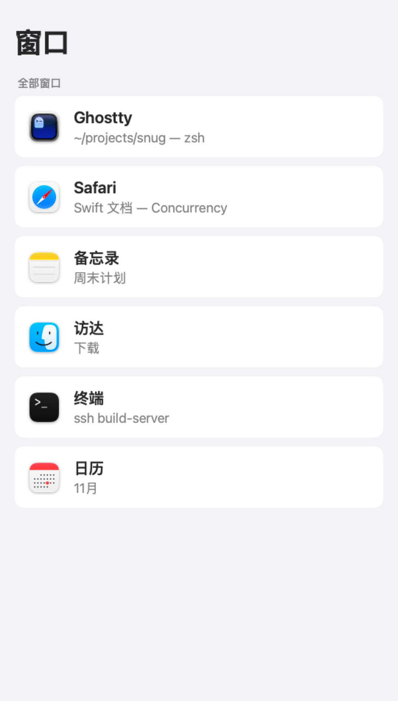
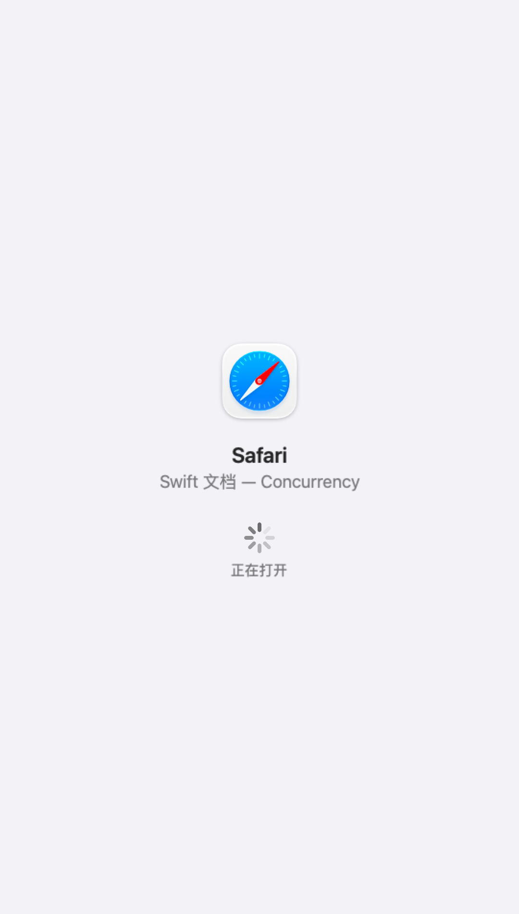
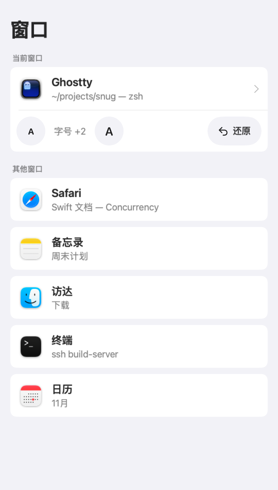

<div align="center">


# Snug

**让 Mac 在手机上拥有原生级的操作体验**

为 UU远程 打造的移动端工作区：独立竖屏、窗口自适应铺满、字号随屏放大、触控遵循 iOS 交互习惯。

[](https://github.com/zephyr4123/snug/releases/latest)


[](LICENSE)

[下载](https://github.com/zephyr4123/snug/releases/latest) · [概览](#概览) · [交互](#与-iphone-一致的交互) · [使用](#使用方式) · [安装](#安装) · [隔离与还原](#隔离与还原) · [已知限制](#已知限制) · [开发](#开发)

<br>




<p><sub>Snug 手机屏：窗口列表 · 正在打开 · 当前窗口与字号</sub></p>

</div>

> Snug 承接自 [aoyamashou/UUyc-companion](https://github.com/aoyamashou/UUyc-companion)（UU远程伴侣，作者 AoyamaShou，MIT 许可），原作者的版权声明与提交历史均完整保留。2.0 起围绕「手机屏」重新设计，原版的设主屏、熄灭物理屏等功能已全部移除。

## 概览

UU远程 会将 Mac 的整块桌面等比压缩进手机屏幕：24 英寸的显示内容落在 6.9 英寸的面板上，文字与控件缩小约四倍；单指滑动被识别为鼠标拖拽，阅读、点选与滚动都难以准确完成。

Snug 运行在被远程的 Mac 上，为手机控制端增加一块按手机比例设计的竖屏。屏上的窗口列表以移动端的方式组织 Mac 上的全部窗口；选中的窗口独占整块屏幕，终端与编辑器自动放大字号，触控操作按 iOS 的习惯重新解释。远程结束后，一切恢复原状。

不切换至这块屏幕时，UU远程 的表现与原版完全一致。Snug 的全部改动只发生在这块屏幕上，并且随时可以还原。

## 与 iPhone 一致的交互

Snug 沿用 iPhone 的交互模型，无需学习新的操作方式。

| iPhone | Snug 手机屏 |
| --- | --- |
| 多任务界面 | 窗口列表：汇集 Mac 上的全部窗口，不论位于哪块显示器、哪个桌面空间，全屏与最小化的窗口同样在列 |
| 打开 App | 选中窗口即独占整块屏幕；原生全屏的窗口自动转为常规窗口，归位时再恢复全屏 |
| 主屏幕指示条 | 底部指示条：轻点或上滑，返回窗口列表 |
| 左上角「‹ 返回」 | 左上角「‹ App 名」：返回当前窗口 |
| 动态字体 | 终端与编辑器自动放大字号，每个 App 的级数分别记忆 |
| 滑动与长按 | 单指滑动即滚动并带有惯性，长按后拖动用于选择，长按松开调出右键菜单 |

切换窗口时，原窗口自动归位并恢复字号；打开过程、空列表与异常情况均有明确的状态提示。触控手势仅在手机屏内生效，且只处理 UU远程 发出的操作，其他显示器以及本机的触控板、鼠标不受影响。

## 使用方式

Snug 安装在被远程的 Mac 上，此后无需任何操作；手机端只需 UU远程。

1. **切换至「Snug 手机屏」**：手机或平板连接后，UU远程 的屏幕列表中会出现这块竖屏（2 倍高清）。控制端为电脑时不会创建。
2. **选择窗口**：在窗口列表中轻点任一窗口，即可将其置于手机屏。
3. **切换与返回**：通过底部指示条回到列表，选择其他窗口时原窗口自动归位；左上角的返回键回到当前窗口。列表中同时提供字号调节与还原。
4. **断开即还原**：远程结束后，窗口回到原位、字号复原，手机屏随之移除。

## 安装

**系统要求**：macOS 14 或更新版本；被远程的 Mac 已安装 [UU远程](https://uuyc.163.com/)。

1. 从 [Releases](https://github.com/zephyr4123/snug/releases/latest) 下载最新的 `Snug-<版本>.dmg`（Apple 芯片与 Intel 通用，已签名并通过 Apple 公证），将 Snug 拖入「应用程序」。
2. 首次打开时，按欢迎页的提示授予辅助功能权限（macOS 27 起名为「设备控制和数据访问」），Snug 同时设为登录时启动。
3. 此后 Snug 常驻菜单栏，仅用于查看状态、打开设置与退出。

<div align="center">


<p><sub>欢迎页与设置：手机屏总开关、触控手势、字号放大、登录时启动、权限状态</sub></p>
</div>

**从源码构建**（需要 Xcode 与 Swift 6）：

```bash
git clone https://github.com/zephyr4123/snug.git
cd snug && scripts/snug install
```

钥匙串中有唯一一张「Developer ID Application」证书时自动使用；否则采用 ad-hoc 签名，此时每次重新构建后都需要重新授权。指定证书的方法见「开发」中的 `.machine.env`。

**从「UU远程伴侣」迁移**：两者同时运行会相互干扰，Snug 启动时会提示退出旧版。若在旧版中启用过守护助手，请再执行：

```bash
launchctl bootout gui/$(id -u)/com.corndog.uudisplay.watchdog-agent
rm ~/Library/LaunchAgents/com.corndog.uudisplay.watchdog-agent.plist
```

## 隔离与还原

- **改动仅限手机屏**：不更改主显示器，不关闭任何屏幕，不触碰其他窗口。创建或移除手机屏时被系统移动的窗口，会被放回原处。
- **先记录，后改动**：窗口置于手机屏之前，其原始位置、全屏与最小化状态、字号级数先写入 `phone-screen.json`，复原后才删除。即使 Snug 意外退出，下次启动或下次放置窗口之前也会按记录还原。
- **无响应时保持原状**：窗口所属的 App 暂时无响应时，Snug 不会强行移动它，也不会丢失还原记录，并在手机屏上说明原因。
- **不联网**：不连接任何服务器，不收集任何数据。

## 已知限制

- **依赖 macOS 未公开的接口**：手机屏通过 `CGVirtualDisplay` 创建，系统大版本更新后可能失效。
- **屏幕比例以 iPhone 17 Pro Max 为准**：540×950 点的竖屏恰好落在 UU远程 底部工具栏以外的可视区域，其他机型可能出现少量黑边。仅提供竖屏，横屏场景请使用 UU远程 原有的屏幕。
- **部分 App 无法完全铺满**：App 自身限定最小宽度时（如系统设置固定为 740 点、Safari 不小于 574 点），窗口无法收窄至 540 点，将靠左放置。
- **字号调节依赖 App 自身的 ⌘+ / ⌘-**：仅对终端与编辑器生效（Ghostty、终端、iTerm2、VS Code、Cursor、Zed）。终端按标签页记忆字号，在手机屏上切换标签页后再还原，字号可能不一致。浏览器按网站记忆缩放，且会影响同一网站的其他窗口，因此不做调整；网页在窄屏下本身即按移动端排版。
- **非网易官方软件**：与 UU远程 及其开发商无任何关联。UU远程 更新后，控制端名称可能无法读取。

## 卸载

1. 在菜单栏中退出 Snug（退出前会先还原窗口）
2. 将「应用程序」中的 Snug 移到废纸篓
3. 可选：删除设置与日志 `rm -rf ~/Library/Application\ Support/Snug ~/Library/Logs/Snug.log*`
4. 可选：在系统设置的「辅助功能」（macOS 27 起为「设备控制和数据访问」）中移除 Snug

## 开发

构建、测试、打包与发布统一由 `scripts/snug` 完成（`scripts/snug help` 查看全部命令）：

| 命令 | 作用 |
| --- | --- |
| `scripts/snug check` | 构建全部产物并运行全部测试（Swift Testing），任一步骤失败即以非零状态退出 |
| `scripts/snug app` | 生成 `build/Snug.app`（通用二进制）并签名 |
| `scripts/snug install` | 生成 App、安装至「应用程序」并打开；正在运行的 Snug 会先正常退出，窗口先行归位 |
| `scripts/snug dist` | 生成可分发的 `dist/<版本>/Snug-<版本>.dmg`：Developer ID 签名，App 与 dmg 分别公证并装订票据 |
| `scripts/snug ship` | 发布：前置检查 → check → dist → 创建 GitHub Release 草稿并上传 → 校验下载地址 → 公开 |

- **版本号**仅记录在仓库根目录的 `VERSION`。发布流程：修改并提交 `VERSION`，打上带说明的同名标签（`git tag -a v2.0.0 -m "…"`）并推送，再执行 `scripts/snug ship`。Release 的说明取自标签说明。
- **已发布的版本不再更改**：GitHub 上已公开、而本机的安装包与之不同时，发布会被拒绝，需提升版本号。`ship` 中断后可直接重新执行，`dist/<版本>/` 中出自同一提交的安装包会被复用。
- **本机配置**存放在不纳入版本控制的 `.machine.env`（模板为 `.machine.env.example`）：签名证书 `MAC_SIGNING_IDENTITY`、公证档案 `MAC_NOTARY_PROFILE`（`xcrun notarytool store-credentials` 存储的档案名）、发布所用的 GitHub 账号 `GH_CONFIG_DIR` / `GITHUB_ACCOUNT`。只记录名称，不存放密钥。

代码分为三层，依赖单向向下：

| 目标 | 内容 |
| --- | --- |
| `SnugCore` | 纯逻辑：连接判定与会话、手机屏调度 `PhoneDesk`、手势翻译 `TouchTranslator`、规格、还原记录、配置、日志、启动参数。系统能力抽象为协议，测试中使用假实现 |
| `SnugSystem` | 系统层：`CGVirtualDisplay` 建屏与撤屏、辅助进程切换 2 倍模式、辅助功能接口移动窗口、按进程发送字号快捷键、手势事件监听 |
| `Snug` | 应用层：UU远程 感知、AppController、手机屏上的窗口列表与指示条、设置、欢迎页、菜单栏 |

启动参数（参数有误时会打印用法）：

| 参数 | 作用 |
| --- | --- |
| `--render-<界面> <目录>` | 将界面渲染为 PNG：`settings` / `welcome` / `about` / `legacy` / `phone`（不启动监控，不改动屏幕） |
| `--preview-phone` | 正常启动，但不等待手机连接即创建手机屏，无需手机即可查看屏上的列表（**会真实创建一块屏幕**） |
| `--dump-uu` | 打印从 UU远程 读取到的控制端与当前屏幕 |
| `--set-mode <屏幕编号> <宽> <高>` | 辅助进程模式：将指定屏幕切换至 2 倍后立即退出（供主程序内部调用） |

数据位于 `~/Library/Application Support/Snug/`：`config.json`（设置）、`phone-screen.json`（手机屏上窗口的还原记录）、`zoom.json`（各 App 记忆的字号级数）。日志位于 `~/Library/Logs/Snug.log`。

<details>
<summary><b>工作原理</b></summary>

- **连接判定**：综合三路信号——UU远程 的覆盖窗口、通过辅助功能接口读取的「本机被控中」表格、`log stream` 中 UURemoteServer 的推流事件；监听启动时先回看最近 4 小时的推流日志，远程进行中启动也能正确识别。连入即时响应，断开从严判定：连续缺席 1.5 秒、已过加撤屏后的 5 秒静默期、推流同时停止，才视为断开。断开后 15 秒内重新连接视为同一次远程，手机屏与屏上的窗口均保留。
- **2 倍高清**：macOS 仅在逻辑尺寸短边不小于 540 点时将 2 倍模式标记为可用，手机屏的尺寸正好落在这一阈值上。`maxPixels` 恰为 2 倍像素且只提供一个模式；系统未自动启用 2 倍时，交由短生命周期的辅助进程切换（由主进程直接切换时，这块屏幕释放后需要 40 秒以上才能下线）。
- **窗口移动**：以「进程号 + 系统窗口编号」识别窗口，跨桌面空间的窗口通过远程令牌定位；依次调整尺寸、位置、尺寸并核对结果，不符则重试，原生全屏的窗口先退出全屏。
- **手势翻译**：在独立线程上监听事件，只接管 UURemoteServer 注入、且在手机屏内按下的鼠标左键：移动不少于 10 点转为带相位的像素滚动并附加惯性；按住 0.5 秒后拖动补发按下事件；按住 0.5 秒后松开改为右键。补发的事件带有标记，避免被再次接管。
</details>

## 致谢

- [UUyc-companion](https://github.com/aoyamashou/UUyc-companion)（MIT）：AoyamaShou，Snug 的前身
- [Better Remote](https://github.com/pincc-debug/better-remote)（MIT）：pincc-debug，为 UU远程 实现单指滚动的思路
- [PermissionFlow](https://github.com/jaywcjlove/PermissionFlow)（MIT）：小弟调调，授权引导与拖拽授权面板
- [FreeDisplay](https://github.com/huberdf/FreeDisplay)（MIT）：huberdf，`CGVirtualDisplay` 接口声明
- 社区 PR 作者：bubble、gencheng liu、Rongzheng Liu（#10，全屏桌面空间下读取 UU远程 窗口）
- 虚拟屏的实现参考了 [DeskPad](https://github.com/Stengo/DeskPad)、[Side Screen](https://github.com/tranvuongquocdat/SideScreen) 与 Chromium 的相关代码

## 许可证

[MIT](LICENSE) © 2026 AoyamaShou，© 2026 zephyr4123
