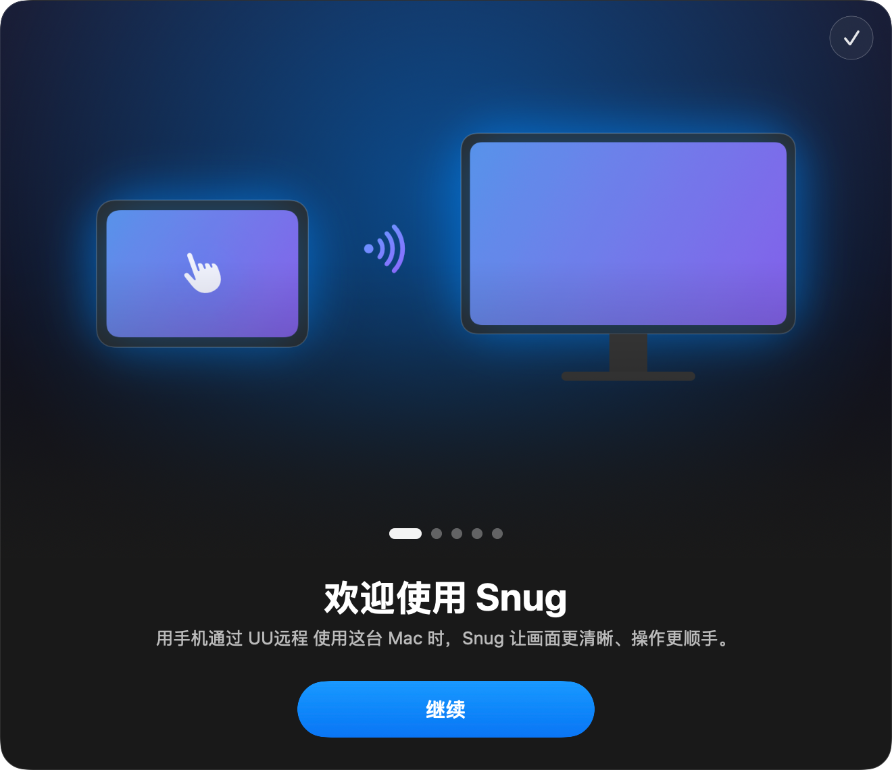
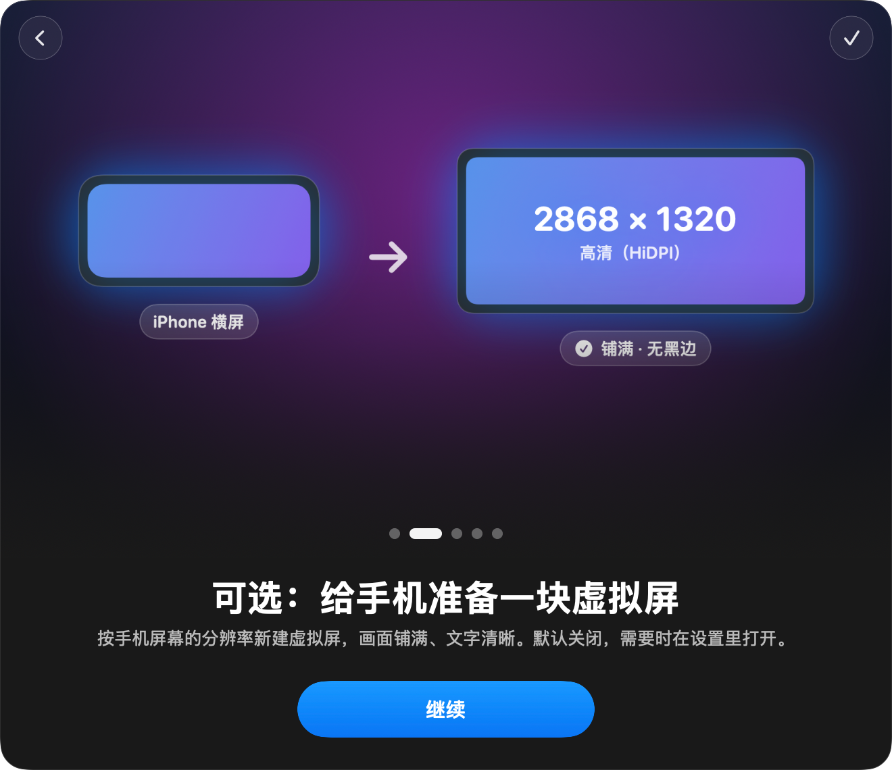
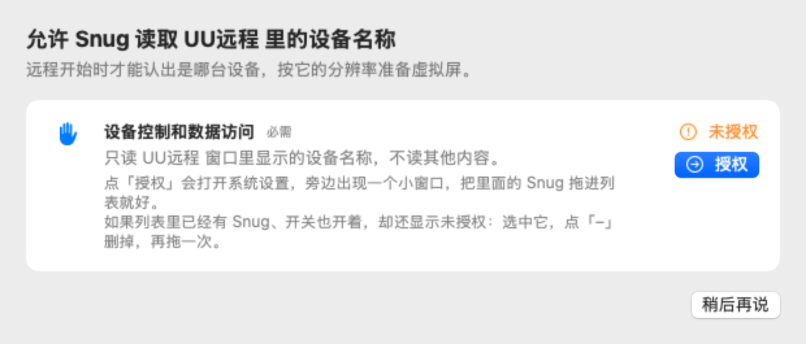
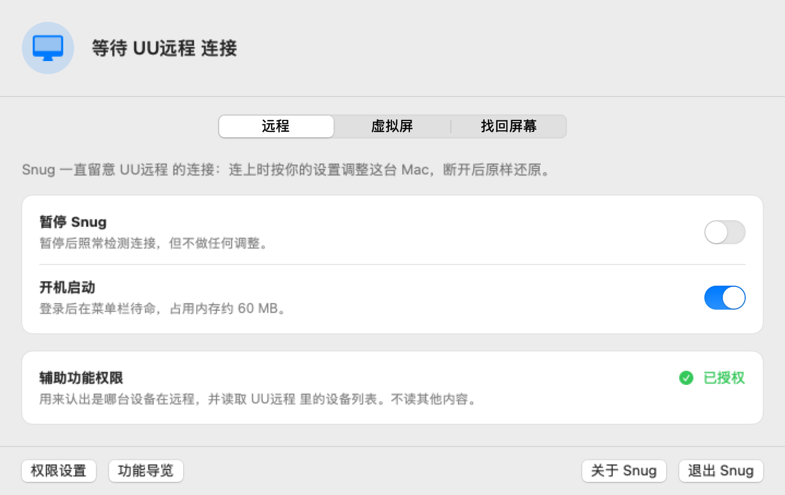
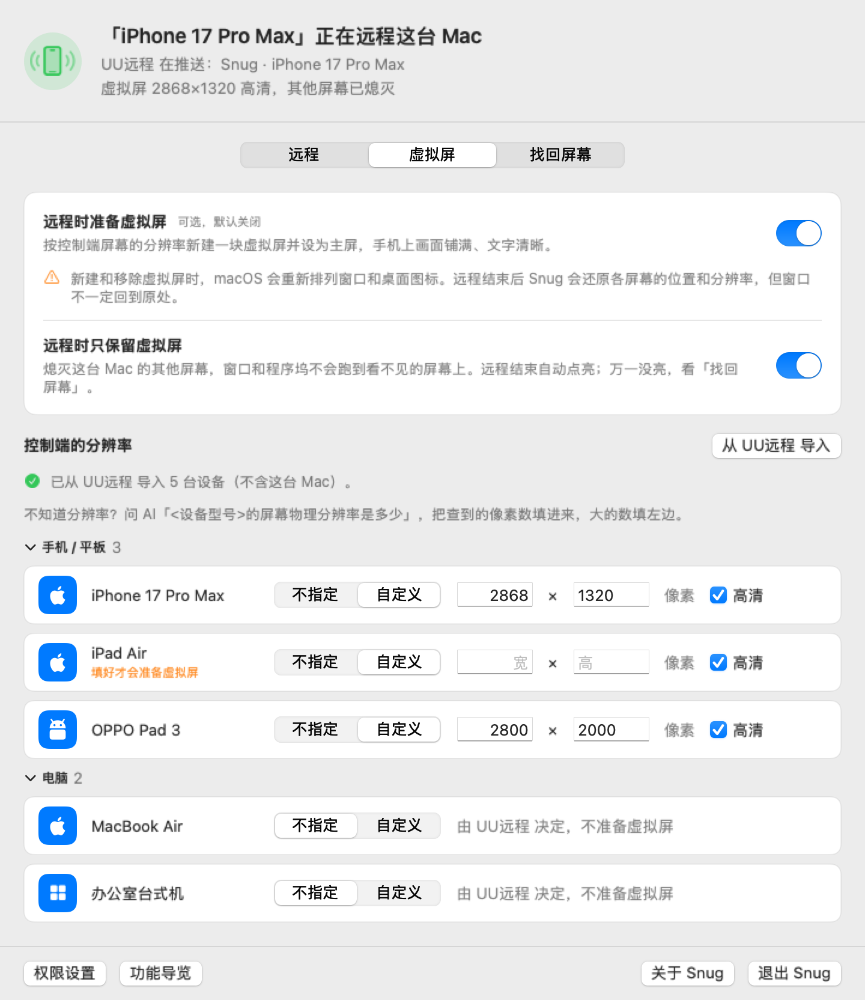

<div align="center">


# Snug

**让用手机通过 UU远程 使用 Mac 时，画面更清晰、界面更大、操作更方便。**


[](LICENSE)

[它是什么](#它是什么) · [安装](#安装) · [使用](#使用) · [找回屏幕](#万一屏幕没亮) · [卸载](#卸载) · [开发](#开发) · [致谢](#致谢)

</div>

> Snug 承接自 [aoyamashou/UUyc-companion](https://github.com/aoyamashou/UUyc-companion)（UU远程伴侣，作者 AoyamaShou，MIT 许可）。原项目停更后由这里接着维护，原作者的版权声明和提交历史都已保留。

## 它是什么

Snug 是一个菜单栏小工具，装在**被远程的 Mac** 上。它一直留意 UU远程 的连接：手机连上时按你的设置调整这台 Mac，断开后原样还原；中途崩溃了，也能靠记录还原。

现在能做的：

| 功能 | 说明 |
| --- | --- |
| 远程会话检测 | 综合 UU远程 的覆盖窗口、「本机被控中」表格和推流日志判断连接，连得快、断得稳；能看到 UU远程 此刻在推哪块屏 |
| 虚拟屏（可选，默认关闭） | 按手机屏幕的分辨率新建一块虚拟屏并设为主屏，画面铺满、文字清晰（HiDPI） |
| 远程时只保留虚拟屏（可选） | 熄灭 Mac 的其他屏幕，窗口和程序坞不会跑到看不见的地方；远程结束自动点亮 |
| 找回屏幕 | 快捷键 ⌃⌥⌘9、可选的看门狗、救急命令行 `snug-rescue`，三重兜底 |
| 不联网 | 不连接任何服务器，不收集任何数据 |

> **关于虚拟屏**：新建和移除虚拟屏时，macOS 会重新排列窗口和桌面图标。远程结束后 Snug 会还原各屏幕的位置和分辨率，但窗口不一定回到原处。所以它是可选功能，默认关闭，需要时在设置里打开。

<div align="center">


</div>

## 安装

**系统要求**：macOS 14 Sonoma 或更新（在 macOS 27 · Apple Silicon 上测试）；被远程的 Mac 上装好 [UU远程](https://uuyc.163.com/)。手机上只需要 UU远程，不用装别的。

还没有发布正式版本，暂时请从源码构建（需要 Xcode 或 Xcode 命令行工具，Swift 6）：

```bash
git clone https://github.com/zephyr4123/snug.git
cd snug && scripts/build-app.sh
```

生成的 App 在 `build/Snug.app`，把它拖进「应用程序」文件夹再打开。

- 签名：设了 `SIGN_IDENTITY` 就用它（`-` 表示 ad-hoc）；没设就自动用钥匙串里唯一的「Developer ID Application」证书；都没有就退回 ad-hoc。ad-hoc 签名每次重新构建后，辅助功能授权都会失效，需要重新授权
- 版本号写在仓库根目录的 `VERSION`

**从旧版「UU远程伴侣」换过来**：两个同时运行会一起改屏幕、互相干扰。Snug 启动时发现旧版在运行会先提示，可以一键退出旧版。之后把旧版从「应用程序」里删掉；如果在旧版里开过守护助手，再运行：

```bash
launchctl bootout gui/$(id -u)/com.corndog.uudisplay.watchdog-agent
rm ~/Library/LaunchAgents/com.corndog.uudisplay.watchdog-agent.plist
```

## 使用

### 第一次打开

1. **功能导览**：5 页图文
2. **授权**：允许 Snug 读取 UU远程 窗口里显示的设备名称。点「授权」会打开系统设置，旁边出现一个小窗口，把里面的 Snug 拖进列表就好。这一项在 macOS 27 里叫「设备控制和数据访问」，更早叫「辅助功能」
3. **设置**：之后 Snug 待在菜单栏里，点图标就能看状态、改设置

<div align="center">

</div>

### 设置窗口

顶部是此刻的状态，用一句话说清：谁在远程、UU远程 在推哪块屏、虚拟屏是什么规格、有没有屏幕熄灭着。下面分三页：

- **远程**：暂停 Snug（照常检测连接，但不做任何调整）、开机启动、辅助功能权限
- **虚拟屏**：可选功能的总开关、远程时只保留虚拟屏、每台控制端设备的分辨率
- **找回屏幕**：快捷键说明、立即恢复屏幕、还原屏幕布局、看门狗

<div align="center">

<p><sub>「远程」页</sub></p>

<p><sub>「虚拟屏」页：正在远程，虚拟屏 2868×1320 已就位</sub></p>
</div>

菜单栏菜单里有同样的状态和常用开关，和设置窗口永远一致。

### 给手机准备虚拟屏

1. 在每台用来远程的手机、平板上登录同一个 UU远程 帐号
2. 设置 › 虚拟屏 › 点「**从 UU远程 导入**」，读出 UU远程「全部设备」里的设备
3. 给手机和平板填**横屏**分辨率，单位是像素，**大的数填左边**，填查到的原始数字，不要除以 2。不知道就问 AI：「<设备型号>的屏幕物理分辨率是多少？」
4. 「高清」保持勾选，文字更清楚
5. 打开「**远程时准备虚拟屏**」

每一行改完自动保存。某一行没填完（例如只填了宽）只会在那一行提示，不影响其他行。电脑选「不指定」，连上时 Snug 什么也不做，交给 UU远程 处理。

只开虚拟屏时，UU远程 不会自动切过去：在手机的 UU远程 里打开「显示」面板，选「Snug · 设备名」。打开「**远程时只保留虚拟屏**」后只剩这一块屏，就不用手动选了。

### 万一屏幕没亮

打开「只保留虚拟屏」后，万一远程结束屏幕还黑着：

1. 坐在 Mac 前按 **⌃ control + ⌥ option + ⌘ command + 9**，所有屏幕立刻点亮，远程不受影响
2. 不在 Mac 前：再远程进来，设置 › 找回屏幕 › 「立即恢复屏幕」
3. 能用终端（例如 ssh 进来）：运行 `/Applications/Snug.app/Contents/MacOS/snug-rescue`，加 `--layout` 同时还原屏幕位置和分辨率
4. 重启 Mac，一定能恢复

建议在「找回屏幕」里打开**看门狗**：Snug 崩溃、卡住超过 10 秒，或已经不用熄屏而屏幕还黑着时，它会自动点亮。打开时 macOS 会提示「SnugWatchdog」已添加后台项目，这是正常的。

在远程中按热键，这次远程就不再熄屏；不在远程中按，只恢复这一下，不影响下一次远程。

## 注意事项

- **用了 macOS 未公开的接口**：建虚拟屏、熄灭屏幕都靠 macOS 没有公开的接口，大版本升级后可能失效，升级系统后先简单试一次
- **熄灭屏幕是可选功能，先了解找回方法**：原作者在极端情况下（短时间内反复增减屏幕）遇到过 macOS 显示服务重启、被注销到登录界面。Snug 一次只做一步屏幕变化、每步都等系统稳定，但无法完全排除这种可能，远程前请保存好重要工作
- **不是网易官方软件**：Snug 与 UU远程 及其开发商没有任何直接、间接或连带关系。它靠读取 UU远程 窗口上的文字识别设备，UU远程 改版后可能读不到
- **隐私**：不联网、不收集数据。授权只用来读取 UU远程 窗口里的设备名称

## 卸载

1. 打开过看门狗的，先在设置 › 找回屏幕里关掉它（会彻底移除）
2. 菜单栏 › 退出 Snug（会先把屏幕还原再退出）
3. 把「应用程序」里的 Snug 移到废纸篓
4. 可选：删除设置和日志 `rm -rf ~/Library/Application\ Support/Snug ~/Library/Logs/Snug.log*`
5. 可选：在系统设置的「设备控制和数据访问（辅助功能）」里删掉 Snug

## 开发

```bash
scripts/check.sh   # 构建全部产物 + 跑全部测试（Swift Testing），任何一步失败都以非零码退出
```

代码分四层，依赖只往下指：

| 目标 | 内容 |
| --- | --- |
| `SnugCore` | 纯逻辑，只依赖 Foundation：连接判定、会话生命周期、推流日志解析、配置与状态文件、日志、虚拟屏模块的决策部分、启动参数、看门狗判定 |
| `SnugDisplays` | CoreGraphics 与私有接口的副作用：建 / 释放虚拟屏、熄灭 / 恢复物理屏的记账、布局快照与还原 |
| `Snug` | App：UU 感知、AppController、看门狗、界面 |
| `snug-rescue` | 救急命令行：按记录恢复物理屏、还原布局 |

调试参数（完整说明见 `Sources/SnugCore/Launch/LaunchMode.swift`，参数写错时也会打印用法）：

| 参数 | 作用 |
| --- | --- |
| `--render-settings / --render-permissions / --render-about / --render-legacy <目录>` | 把界面渲染成 PNG（不启动监控、不碰显示器） |
| `--render-tour <目录>`、`--render-tour-ui <配图目录> <目录>` | 渲染导览配图（`Assets/Tour`）与导览页 |
| `--dump-uu` | 打印从 UU远程 读到的设备与控制端 |
| `--watchdog` | 看门狗模式（由 launchd 托管） |
| `--simulate "<设备名>[>设备名]" [秒]`、`--stress <轮数> [--slow]` | 用脚本化的信号驱动完整流程，**会真的建虚拟屏、熄灭屏幕**，有人在远程这台 Mac 时不要运行 |

数据都在 `~/Library/Application Support/Snug/`：`config.json`（设置）、`disabled-displays.json`（被熄灭的屏，先记账再熄灭）、`layout.json`（远程前的布局，还原成功才删）、`app-state.json`（主程序每秒写，看门狗据此判断）。日志在 `~/Library/Logs/Snug.log`。

<details>
<summary><b>工作原理</b></summary>

- **检测连接**：三路信号——UU远程 被操控时铺在屏幕上的覆盖窗口、辅助功能接口读到的「本机被控中」表格、`log stream` 里 UURemoteServer 的推流事件。连入要快，一看到就算；断开要稳，连续缺席 1.5 秒、过了自己改屏幕后的 5 秒静默期、推流也停了才算
- **会话**：断开后 15 秒内再连上算同一次远程，「这次远程不再熄屏」之类的决定保留
- **虚拟屏**：CoreGraphics 未公开的 `CGVirtualDisplay`，同一台设备固定同一个序列号，不会让 macOS 每次都当成新显示器
- **熄灭物理屏**：未公开的 `CGSConfigureDisplayEnabled`。先把屏幕编号写进记录再熄灭，恢复成功才销账；断开时立刻恢复，虚拟屏再留 10 秒，重连就直接复用
- **看门狗**：独立的 LaunchAgent 进程，每 5 秒看一眼主程序写的状态文件，主程序不在、卡住或已不需要熄屏时按记录恢复
</details>

## 致谢

- [UUyc-companion](https://github.com/aoyamashou/UUyc-companion)（MIT）：AoyamaShou，Snug 承接自这个项目
- [PermissionFlow](https://github.com/jaywcjlove/PermissionFlow)（MIT）：小弟调调，授权引导与拖拽授权面板
- [TourKit](https://github.com/rampatra/TourKit)（MIT）：Ram Patra，功能导览
- [FreeDisplay](https://github.com/huberdf/FreeDisplay)（MIT）：huberdf，`CGVirtualDisplay` 接口声明
- 社区 PR 的作者：bubble（#14，稳定序列号）、gencheng liu（#12，已亮着的屏直接销账）、Rongzheng Liu（#10，全屏 Space 下读取 UU 窗口、布局记录保留到还原成功）
- 虚拟屏的实现思路参考了 [DeskPad](https://github.com/Stengo/DeskPad)、[Side Screen](https://github.com/tranvuongquocdat/SideScreen) 和 Chromium 的相关代码

## 许可证

[MIT](LICENSE) © 2026 AoyamaShou，© 2026 zephyr4123
