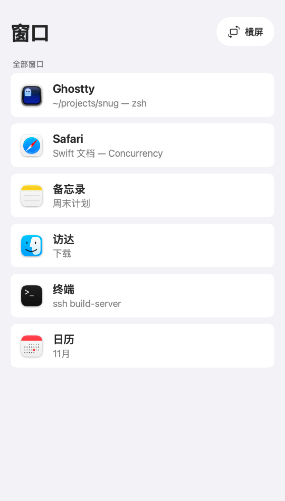
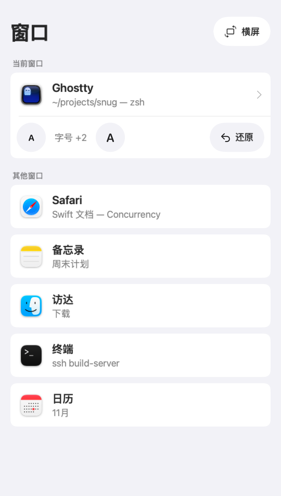
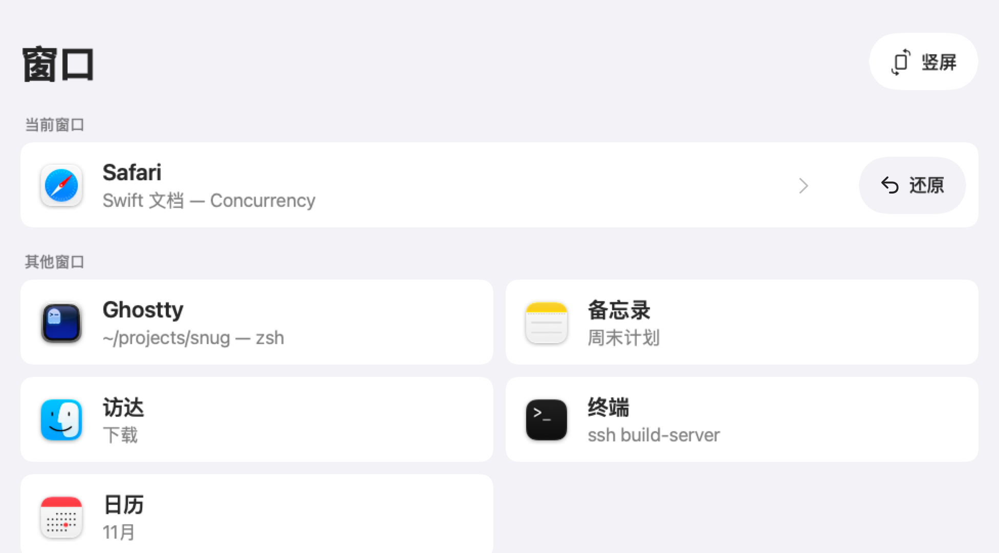
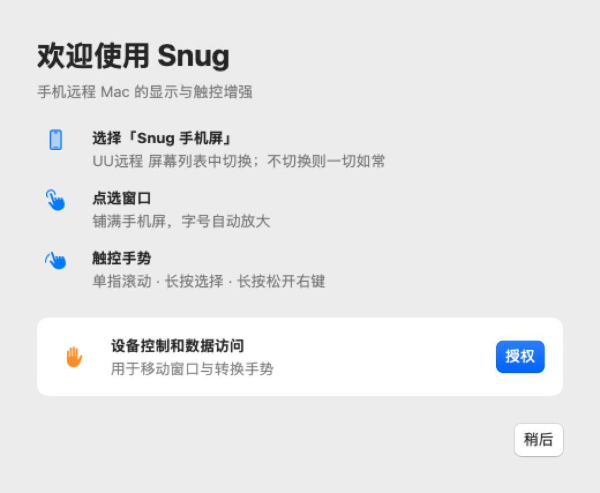
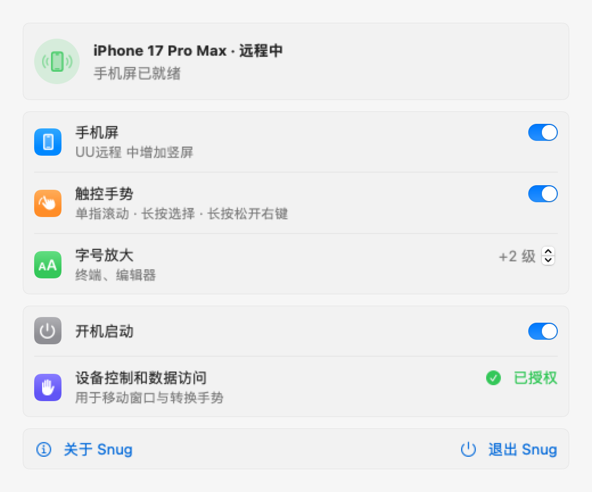

<div align="center">


# Snug

**手机远程 Mac 的显示与触控增强**

用手机通过 UU远程 用 Mac 时，窗口铺满手机、字号够大、手势顺手。


[](LICENSE)

[用法](#用法) · [安装](#安装) · [隔离与还原](#隔离与还原) · [卸载](#卸载) · [开发](#开发) · [致谢](#致谢)

</div>

> Snug 承接自 [aoyamashou/UUyc-companion](https://github.com/aoyamashou/UUyc-companion)（UU远程伴侣，作者 AoyamaShou，MIT 许可），原作者的版权声明和提交历史都已保留。2.0 起按「手机屏」重新设计，原版的设主屏、熄灭物理屏一整套已移除。

## 为什么

24 寸外接屏塞进 6.9 寸手机，所有东西缩小约 4 倍：字看不清，按钮点不准，单指一滑就选中文字。Snug 在 Mac 上多加一块按手机比例做的屏，只放一个窗口，铺满、放大字号，再把单指操作翻译成 iPhone 的手势。

## 用法

Snug 装在**被远程的 Mac** 上，之后不用再管。手机上只需要 UU远程。

1. **切到「Snug 手机屏」**：手机连上后，UU远程 的屏幕列表里多出这一块竖屏（2 倍高清）。不切过去，一切和原版 UU远程 一样。
2. **点选窗口**：手机屏上是 Snug 的窗口列表。点一个，它就铺满手机屏，终端、编辑器的字号自动放大。
3. **随时切换**：底部小横条点一下或上滑，回到列表；换窗口时旧窗口自动回原位、字号缩回。列表里还能横屏 / 竖屏、调字号、还原。
4. **断开即还原**：远程结束，窗口回原位、字号缩回、手机屏移除。

手机屏上的手势：

| 手势 | 效果 |
| --- | --- |
| 点 | 点击（双击照常） |
| 单指滑动 | 滚动，松手带惯性 |
| 按住再拖 | 选择 |
| 按住松开 | 右键菜单（拷贝、粘贴） |

手势只在手机屏上生效，只接管 UU远程 发来的操作；原来的屏幕、本机的触控板和鼠标不受影响。

<div align="center">


<br>

<p><sub>手机屏上的窗口列表：竖屏、竖屏（已放一个窗口）、横屏</sub></p>
</div>

## 安装

**系统要求**：macOS 14 或更新（在 macOS 27 · Apple Silicon 上测试），被远程的 Mac 上装好 [UU远程](https://uuyc.163.com/)。

正式版发布后从 [Releases](https://github.com/zephyr4123/snug/releases/latest) 下载 dmg（已公证，Apple 芯片和 Intel 通用），把 Snug 拖进「应用程序」。在那之前请从源码构建（需要 Xcode，Swift 6），一行装好并打开：

```bash
git clone https://github.com/zephyr4123/snug.git
cd snug && scripts/snug install
```

第一次打开会出现欢迎页：授予辅助功能权限（macOS 27 起叫「设备控制和数据访问」），Snug 同时设为开机启动。之后它待在菜单栏，只用来看状态、打开设置、退出。

<div align="center">


<p><sub>欢迎页与设置：手机屏总开关、触控手势、字号放大、开机启动、辅助功能</sub></p>
</div>

- 签名：钥匙串里有唯一一张「Developer ID Application」证书时自动用它，没有就 ad-hoc（每次重新构建后，辅助功能授权都要重给）。要指定证书，见下面「开发」里的 `.machine.env`
- **从旧版「UU远程伴侣」换过来**：两者同时运行会相互干扰，Snug 启动时会提示退出旧版。旧版里开过守护助手的，再运行：

  ```bash
  launchctl bootout gui/$(id -u)/com.corndog.uudisplay.watchdog-agent
  rm ~/Library/LaunchAgents/com.corndog.uudisplay.watchdog-agent.plist
  ```

## 隔离与还原

- **只动手机屏**：不设主屏、不关屏幕、不碰其它窗口。加屏、撤屏时 macOS 会把上次留在这块屏上的窗口拉过去，Snug 会放回原处。
- **先记账再改动**：放上手机屏的窗口，原位、是否全屏、字号级数先写进 `phone-screen.json`，放回原位才删。Snug 崩溃时 macOS 会自动撤掉手机屏，下次启动按记录还原。
- **控制端是电脑时不加手机屏**；读不到控制端名字（UU远程 主窗口没开）时按手机处理。
- **不联网**：不连接任何服务器，不收集任何数据。

## 注意事项

- **用了 macOS 未公开的接口**：建手机屏靠 `CGVirtualDisplay`，系统大版本升级后可能失效。
- **手机屏的比例按 iPhone 17 Pro Max 定**：竖屏 540×950 点、横屏 976×540 点，正好落在 UU远程 不被灵动岛和工具栏遮挡的区域。其它机型可能留一点黑边。
- **字号靠 App 自己的 ⌘+ / ⌘-**：只对名单里的终端和编辑器生效（Ghostty、终端、iTerm2、VS Code、Cursor、Zed）。终端按标签页记字号，手机屏上换了标签页再还原，字号可能对不上。浏览器不调：它按网站记缩放、会连带同一网站的其它窗口，改了收不回来；网页在手机屏上本来就按窄屏排版。
- **横竖切换会换一块屏**：UU远程 可能需要重新选一次「Snug 手机屏」。
- **不是网易官方软件**：与 UU远程 及其开发商无任何关联。UU远程 改版后，控制端名称可能读不到。

## 卸载

1. 菜单栏 › 退出 Snug（先还原窗口再退出）
2. 把「应用程序」里的 Snug 移到废纸篓
3. 可选：删除设置和日志 `rm -rf ~/Library/Application\ Support/Snug ~/Library/Logs/Snug.log*`
4. 可选：在系统设置的「辅助功能」里删掉 Snug

## 开发

构建、测试、打包、发版都走 `scripts/snug` 这一个入口（`scripts/snug help` 看全部）：

| 命令 | 作用 |
| --- | --- |
| `scripts/snug check` | 构建全部产物，跑全部测试（Swift Testing）；任何一步失败都以非零码退出 |
| `scripts/snug app` | 打 `build/Snug.app`（通用二进制）并签名 |
| `scripts/snug install` | 打 App，装进「应用程序」并打开；正在跑的 Snug 先正常退出（窗口先放回原处） |
| `scripts/snug dist` | 打可分发的 `dist/<版本>/Snug-<版本>.dmg`：Developer ID 签名，App 和 dmg 各自公证、钉票据 |
| `scripts/snug ship` | 发版：把关 → check → dist → GitHub Release 草稿、传包 → 从下载地址核对 → 公开 |

- **版本号**只写在仓库根目录的 `VERSION`。发版：改好并提交，打带说明的同名标签（`git tag -a v2.0.0 -m "…"`）推上去，再 `scripts/snug ship`。Release 的说明取自标签说明
- **发过的版本不改**：GitHub 上已经公开、包又和本机的不一样就拒绝，要改就升版本号。ship 中途断了直接重跑：`dist/<版本>/` 里出自同一个提交的包会直接用，不重新打包
- **本机配置**放在不进 git 的 `.machine.env`（样板 `.machine.env.example`）：签名证书 `MAC_SIGNING_IDENTITY`、公证档案 `MAC_NOTARY_PROFILE`（`xcrun notarytool store-credentials` 存的档案名）、发版用的 GitHub 账号 `GH_CONFIG_DIR` / `GITHUB_ACCOUNT`。只放名字，不放密钥

代码分三层，依赖只往下指：

| 目标 | 内容 |
| --- | --- |
| `SnugCore` | 纯逻辑：连接判定与会话、手机屏调度 `PhoneDesk`、手势翻译 `TouchTranslator`、规格、还原记录、配置、日志、启动参数。系统能力抽象成协议，测试里用假实现 |
| `SnugSystem` | 系统层：`CGVirtualDisplay` 建屏撤屏、帮手进程切 2 倍、辅助功能搬窗口、按 pid 发字号按键、手势事件监听 |
| `Snug` | App：UU 感知、AppController、手机屏上的窗口列表与小横条、设置、欢迎页、菜单栏 |

启动参数（参数写错时会打印用法）：

| 参数 | 作用 |
| --- | --- |
| `--render-<界面> <目录>` | 把界面渲染成 PNG：`settings` / `welcome` / `about` / `legacy` / `phone`（不启动监控、不碰屏幕） |
| `--preview-phone` | 正常启动，但不等手机连上就加手机屏，没有手机也能看手机屏上的列表（**会真的加一块屏**） |
| `--dump-uu` | 打印从 UU远程 读到的控制端和此刻的屏幕 |
| `--set-mode <屏幕编号> <宽> <高>` | 帮手模式：把屏切到 2 倍后立即退出（主程序内部用） |

数据在 `~/Library/Application Support/Snug/`：`config.json`（设置）、`phone-screen.json`（手机屏上窗口的还原记录）、`zoom.json`（每个 App 记住的字号级数）。日志在 `~/Library/Logs/Snug.log`。

<details>
<summary><b>工作原理</b></summary>

- **检测连接**：三路信号——UU远程 的覆盖窗口、辅助功能读到的「本机被控中」表格、`log stream` 里 UURemoteServer 的推流事件。连入要快，断开要稳：连续缺席 1.5 秒、过了加撤屏后的 5 秒静默期、推流也停了才算断开。断开后 15 秒内重连算同一次远程，手机屏和上面的窗口都保留。
- **2 倍高清**：macOS 只在逻辑尺寸短边 ≥540 点时才把 2 倍模式标为可用，手机屏的尺寸卡在这条线上。`maxPixels` 正好等于 2 倍像素、只给一个模式；系统没给 2 倍时，交给短命的帮手进程切（主程序亲自切模式，这块屏释放时会拖 40 秒以上才下线）。
- **横竖切换**：先撤旧屏再建新屏——两块手机屏同时在时切好的 2 倍，旧屏一撤会被系统退回 1 倍。
- **搬窗口**：窗口按「进程号 + 系统窗口编号」认；先改大小、再挪、再改大小，核对不上就重试，原生全屏的先退出全屏。
- **手势翻译**：独立线程上的事件监听，只接管 UURemoteServer 注入、在手机屏里按下的鼠标左键：移动 ≥10 点转成带相位的像素滚动并补惯性，按住 0.5 秒再拖补发按下，按住 0.5 秒松开改成右键。补发的事件打上记号，免得被自己再接管。
</details>

## 致谢

- [UUyc-companion](https://github.com/aoyamashou/UUyc-companion)（MIT）：AoyamaShou，Snug 的前身
- [Better Remote](https://github.com/pincc-debug/better-remote)（MIT）：pincc-debug，给 UU远程 做单指滚动的思路
- [PermissionFlow](https://github.com/jaywcjlove/PermissionFlow)（MIT）：小弟调调，授权引导与拖拽授权面板
- [FreeDisplay](https://github.com/huberdf/FreeDisplay)（MIT）：huberdf，`CGVirtualDisplay` 接口声明
- 社区 PR 的作者：bubble、gencheng liu、Rongzheng Liu（#10，全屏 Space 下读取 UU 窗口）
- 虚拟屏的实现参考了 [DeskPad](https://github.com/Stengo/DeskPad)、[Side Screen](https://github.com/tranvuongquocdat/SideScreen) 和 Chromium 的相关代码

## 许可证

[MIT](LICENSE) © 2026 AoyamaShou，© 2026 zephyr4123
